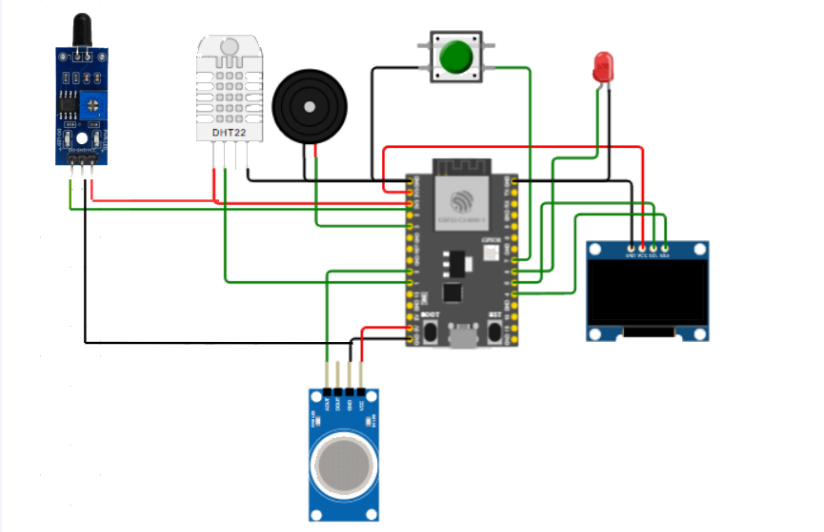
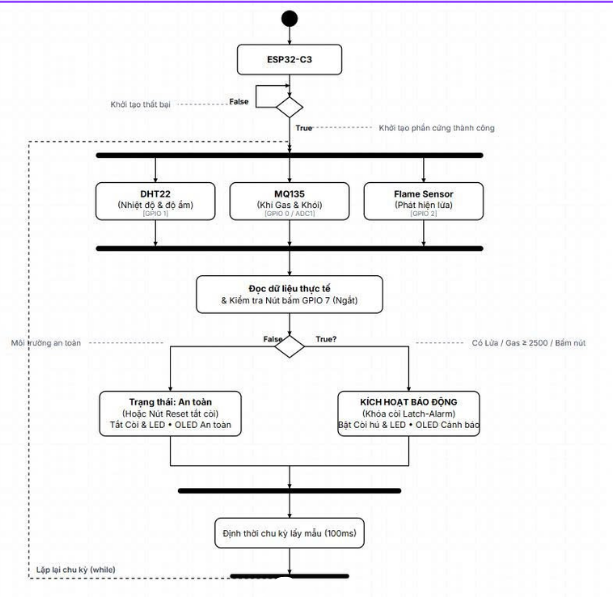
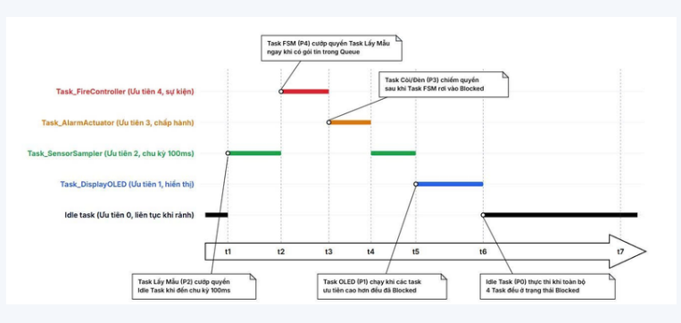
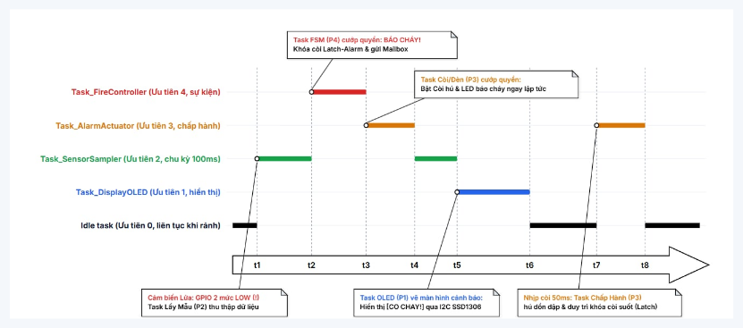
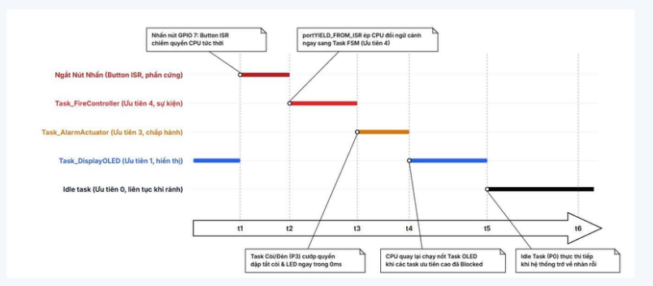

# Smart Fire & Hazard Warning System

An ESP32-C3-based fire and hazardous-gas monitoring prototype built with **ESP-IDF, C, and FreeRTOS**. It monitors environmental sensors and provides audible, visual, and OLED alerts when a potential hazard is detected.

> **Safety notice:** This is an educational prototype, not a certified fire alarm or life-safety system. Validate sensor thresholds, wiring, and response behavior before testing. Do not rely on this project as the sole means of fire or gas protection.

## Features

- Flame detection using a digital flame sensor
- Gas/air-quality monitoring using an MQ-135 module
- Temperature and humidity monitoring using DHT22
- FreeRTOS multitasking with dedicated sensor, controller, actuator, and display tasks
- Queue-based communication between tasks
- Interrupt-driven emergency push button
- FSM-based alarm-state management
- Buzzer, LED, and SSD1306 OLED notifications

## Hardware

| Component | Purpose |
|---|---|
| ESP32-C3 DevKit | Main controller |
| MQ-135 module | Gas/air-quality sensing |
| DHT22 | Temperature and humidity |
| Flame sensor | Flame detection |
| SSD1306 OLED (128×64, I²C) | Status display |
| Buzzer and LED | Audible and visual alerts |
| Push button | Manual emergency trigger |

**Wiring notes:** Check the pin assignments in `main/include/config.h` and confirm them against your board. MQ-135 modules commonly require a 5 V heater supply; verify the module's output voltage is safe for ESP32-C3 GPIO/ADC inputs. Use a common ground and check the DHT22 pull-up requirements.

## System Diagrams

### Hardware Schematic


### System Flowchart


## FreeRTOS Architecture

| Task | Responsibility |
|---|---|
| `Task_SensorSampler` | Samples sensors periodically and publishes sensor events |
| `Task_FireController` | Processes events and manages alarm state |
| `Task_AlarmActuator` | Controls buzzer and LED patterns |
| `Task_DisplayOLED` | Updates the OLED dashboard |

The firmware uses three queues:

- `xSystemEventQueue` — sensor and emergency-button events
- `xAlarmLevelQueue` — latest alarm level for the actuator task
- `xDisplayQueue` — latest dashboard data for the OLED task

The emergency-button ISR submits an event using an ISR-safe queue API. The controller then handles the event in task context.

### FreeRTOS Scheduling Timelines

**Normal operation**



**Fire detection**



**Emergency button interrupt**



> The timelines are conceptual illustrations. Actual scheduling depends on task priorities, blocking states, interrupt activity, and execution time. `vTaskDelayUntil()` maintains a periodic release schedule but does not guarantee execution at an exact instant when a higher-priority task is ready.

## Project Structure

```text
fire_alarm_RTOS/
├── images/
│   ├── hardware-schematic.png
│   ├── system-flowchart.png
│   ├── freertos-timeline-normal.png
│   ├── freertos-timeline-fire.png
│   └── freertos-timeline-button-isr.png
├── fire_alarm-main/
│   ├── main/
│   │   ├── include/
│   │   ├── main.c
│   │   ├── dht22.c
│   │   ├── flame.c
│   │   ├── mq135.c
│   │   └── oled_ssd1306.c
│   ├── CMakeLists.txt
│   ├── README.md
│   └── BAO_CAO_HE_THONG_BAO_CHAY.md
└── README.md
```

## Build and Flash

Install and configure ESP-IDF, then run these commands from the ESP-IDF project directory (currently `fire_alarm-main/`, where `CMakeLists.txt` is located):

```bash
idf.py set-target esp32c3
idf.py build
idf.py -p PORT flash monitor
```

Replace `PORT` with the serial port assigned to your ESP32-C3 board.

## Validation Checklist

- [ ] Confirm GPIO assignments and sensor output polarity.
- [ ] Verify sensor readings and OLED updates.
- [ ] Calibrate and validate the MQ-135 threshold for the intended environment.
- [ ] Test buzzer/LED patterns and emergency-button behavior.
- [ ] Confirm queue behavior and error handling under expected conditions.

## Technologies

**ESP32-C3 · C · ESP-IDF · FreeRTOS · CMake**

## Author

Embedded systems and IoT project focused on sensor integration, real-time task scheduling, and event-driven alarm control.
