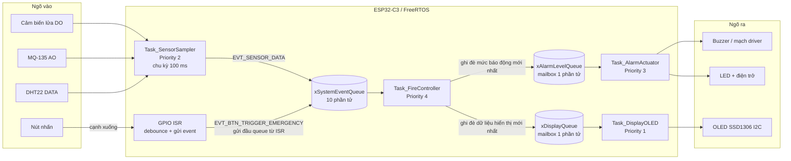
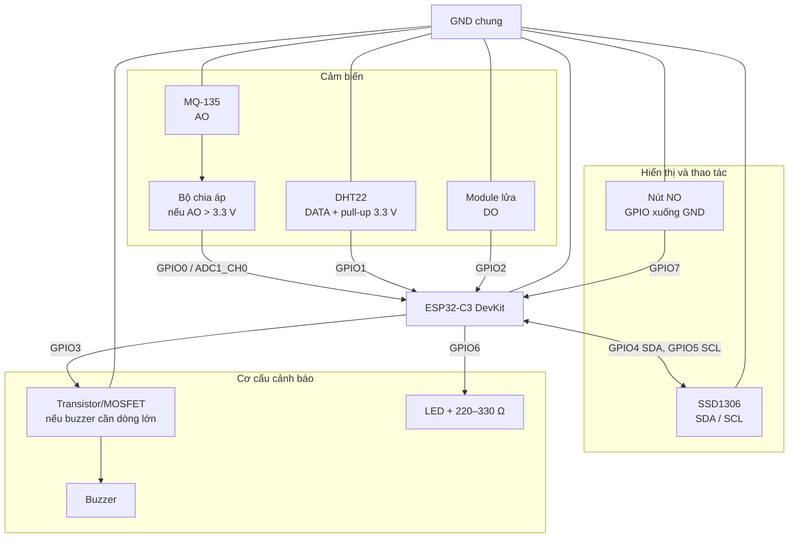
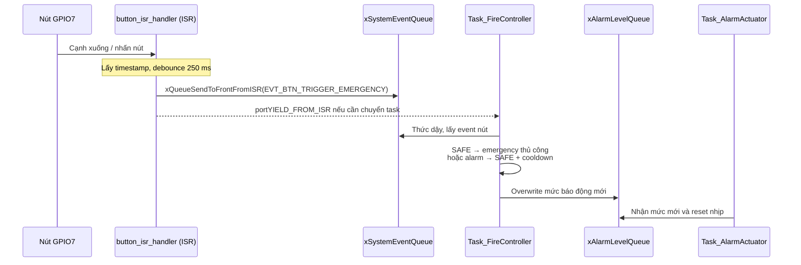

# BÁO CÁO HỆ THỐNG CẢNH BÁO CHÁY VÀ KHÍ GAS

> Tài liệu nền để làm slide và thuyết trình. Nội dung phần mềm được đối chiếu với mã nguồn ESP-IDF hiện tại. Các sơ đồ Mermaid có thể xem bằng Markdown Preview hỗ trợ Mermaid hoặc chuyển thành hình để đưa vào slide.

## 1. Tóm tắt đề tài

Đề tài xây dựng một hệ thống nhúng phát hiện nguy cơ từ ba loại đầu vào: cảm biến lửa, cảm biến khí MQ-135 và cảm biến nhiệt độ/độ ẩm DHT22. Vi điều khiển ESP32-C3 đọc cảm biến, hợp nhất dữ liệu để phân loại trạng thái, sau đó điều khiển còi, LED và màn hình OLED. Nút nhấn nối với ngắt GPIO cho phép kích hoạt báo động thủ công hoặc xác nhận/reset báo động.

Phần mềm chạy trên ESP-IDF và FreeRTOS, chia chức năng thành các Task độc lập. Các Queue truyền dữ liệu giữa những Task và từ ISR sang Task; ISR chỉ ghi nhận sự kiện nút nhấn rồi hoãn xử lý trạng thái sang Task điều khiển.

### Mục tiêu

- Lấy mẫu cảm biến định kỳ và không dùng vòng chờ bận cho toàn hệ thống.
- Kết hợp nhiều điều kiện cảm biến để phân biệt an toàn, cảnh báo khí và báo cháy.
- Phát cảnh báo bằng còi/LED, hiển thị tình trạng và số đo trên OLED.
- Đáp ứng thao tác nút nhấn qua GPIO interrupt.
- Minh họa các khái niệm FreeRTOS: Task, priority, periodic task, queue, mailbox, ISR-to-task và deferred interrupt processing.

### Phạm vi và tuyên bố an toàn

Đây là mô hình học tập/thử nghiệm. MQ-135 dạng module cùng ngưỡng ADC thô không phải thiết bị đo nồng độ khí đã hiệu chuẩn; cảm biến lửa và thuật toán chưa được chứng nhận. Không dùng hệ thống thay cho thiết bị báo cháy, báo gas đạt chuẩn hoặc làm căn cứ bảo đảm an toàn công trình.

## 2. Kiến trúc tổng thể



**Luồng chính:** cảm biến → `Task_SensorSampler` → `xSystemEventQueue` → `Task_FireController` → hai mailbox → Task điều khiển còi/LED và Task OLED. Luồng nút nhấn đi từ GPIO ISR vào đầu `xSystemEventQueue`, không tính toán trạng thái báo động trực tiếp trong ISR.

## 3. Danh sách linh kiện

| STT | Linh kiện | Số lượng | Vai trò / lưu ý |
|---:|---|---:|---|
| 1 | ESP32-C3 DevKit | 1 | Vi điều khiển chạy ứng dụng FreeRTOS. Pin map hiện tại dành cho ESP32-C3. |
| 2 | MQ-135 hoặc module MQ-135 | 1 | Đo đáp ứng khí tổng hợp qua ngõ analog AO; heater của cảm biến thường cần nguồn 5 V. Cần làm nóng và hiệu chuẩn theo module thực tế. |
| 3 | DHT22/AM2302 hoặc module DHT22 | 1 | Đo nhiệt độ, độ ẩm. Module thường có sẵn điện trở kéo lên; cảm biến rời cần điện trở kéo DATA lên 3.3 V. |
| 4 | Module cảm biến lửa có ngõ DO | 1 | Firmware đọc digital output; mức LOW được hiểu là phát hiện lửa. |
| 5 | OLED SSD1306 128×64 I2C | 1 | Hiển thị trạng thái và các số đo; địa chỉ cấu hình là `0x3C`. |
| 6 | Buzzer chủ động | 1 | Phát âm báo theo trạng thái. Chọn đúng điện áp/dòng; ưu tiên điều khiển qua transistor/MOSFET. |
| 7 | LED báo trạng thái | 1 | Nhấp nháy cùng báo động; mắc nối tiếp điện trở hạn dòng 220–330 Ω. |
| 8 | Nút nhấn thường hở (NO) | 1 | Nối GPIO7 xuống GND khi nhấn; firmware bật pull-up nội. |
| 9 | Điện trở kéo lên 4.7–10 kΩ | 1 nếu cần | Dùng cho DATA DHT22 loại rời nếu chưa tích hợp trên board. |
| 10 | Điện trở chia áp cho AO MQ-135 | 2 nếu cần | Bảo vệ ADC ESP32-C3 khi module MQ-135 được cấp 5 V và AO có thể vượt 3.3 V. Ví dụ 12 kΩ nối tiếp từ AO và 20 kΩ từ chân ADC xuống GND (tỉ số cần kiểm tra theo mức AO thật). |
| 11 | NPN/MOSFET logic-level và điện trở base/gate | 1 bộ nếu cần | Driver đóng/ngắt buzzer nếu dòng tải vượt khả năng GPIO; GPIO chỉ đưa tín hiệu điều khiển. |
| 12 | Nguồn USB 5 V ổn định, breadboard/dây nối | 1 bộ | Cấp nguồn cho board và module theo thông số thực tế. Tất cả phải có GND chung. |

### Hình minh họa nguyên lý phần cứng

Sơ đồ sau là hình khối kết nối để dựng lại bằng KiCad, Fritzing, Proteus hoặc vẽ lại trên slide. Đây không phải ảnh chụp prototype vật lý.



> **Ảnh prototype:** thư mục mã nguồn hiện không có ảnh chụp thiết bị đã lắp. Để hoàn thiện slide, nhóm nên chụp ảnh thật từ trên xuống và ảnh cận cảnh dây/board, rồi chèn tại đây hoặc vào slide “Mô hình thực tế”. Không nên dùng sơ đồ khối ở trên làm bằng chứng ảnh hệ thống đã lắp.

## 4. Bảng nối dây

Pin map lấy từ `main/include/config.h`; tên chân trên board cần đối chiếu silkscreen của đúng phiên bản DevKit.

| ESP32-C3 | Nối tới | Kiểu tín hiệu / ghi chú |
|---|---|---|
| GPIO0 (ADC1_CH0) | MQ-135 AO qua bộ chia áp phù hợp | Analog input; không để điện áp tại GPIO vượt giới hạn ESP32-C3. |
| GPIO1 | DHT22 DATA | Digital hai chiều theo giao thức DHT; kéo lên 3.3 V nếu module chưa có pull-up. |
| GPIO2 | Module lửa DO | Digital input active-low theo code. Kiểm tra mức logic đầu ra module và trạng thái boot/strapping của board. |
| GPIO3 | Điều khiển buzzer qua transistor/MOSFET nếu cần | Firmware xuất mức HIGH/LOW; không cấp tải dòng lớn trực tiếp từ GPIO. |
| GPIO4 | OLED SDA | I2C data. |
| GPIO5 | OLED SCL | I2C clock, cấu hình 100 kHz. |
| GPIO6 | Anode LED qua điện trở hạn dòng | Cathode LED về GND. |
| GPIO7 | Một đầu nút nhấn NO | Đầu còn lại về GND; pull-up nội và interrupt cạnh xuống. |
| 3V3 | OLED, DHT22 và module lửa nếu module hỗ trợ 3.3 V | Kiểm tra điện áp hoạt động của từng breakout. |
| 5V/VIN | MQ-135 heater/module, nếu yêu cầu; buzzer nếu đúng định mức | Không nối 5 V vào GPIO hoặc ADC. |
| GND | GND tất cả module và nguồn driver | GND chung là bắt buộc để tham chiếu tín hiệu. |

### Ghi chú điện áp và lắp ráp

1. ADC ESP32-C3 không chịu được 5 V. Module MQ-135 cấp 5 V có thể đưa AO gần 5 V; đo AO và tính divider theo điện áp cực đại module. Ví dụ divider 12 kΩ từ AO tới ADC và 20 kΩ từ ADC xuống GND cho khoảng 3.125 V khi AO = 5 V. Giá trị thực tế cần kiểm tra, không coi ví dụ là hiệu chuẩn.
2. Không nối đầu ra 5 V của module lửa vào GPIO. Cấp module ở 3.3 V nếu nhà sản xuất cho phép, hoặc chuyển mức logic thích hợp.
3. Dùng pull-up ngoài cho DHT22 loại rời. Kiểm tra thứ tự chân theo nhãn datasheet/module; thứ tự vật lý không thống nhất giữa các nhà sản xuất.
4. Nút nhấn được nối GPIO7–GND. Không đưa nguồn 5 V vào nút/GPIO.
5. Buzzer có thể là loại chủ động hoặc thụ động. Firmware chỉ bật/tắt GPIO, không tạo sóng âm PWM; buzzer thụ động có thể không kêu đúng nếu không có mạch/tần số điều khiển phù hợp.
6. GPIO2 có thể có chức năng strap trên một số board ESP32-C3. Kiểm tra mạch DO không giữ chân ở mức gây ảnh hưởng lúc reset/boot; nếu có, chọn GPIO phù hợp khác và sửa firmware cùng sơ đồ.

## 5. Chức năng và thuật toán cảnh báo

### Các mức trạng thái

| Trạng thái | Ý nghĩa | Đầu ra theo firmware |
|---|---|---|
| `LEVEL_SAFE` | Không có điều kiện cảnh báo | Buzzer OFF, LED OFF; OLED hiển thị nhiệt độ và ADC gas. |
| `LEVEL_GAS_ALERT` | ADC khí đạt ngưỡng gas | Buzzer/LED theo nhịp cảnh báo gas; OLED hiển thị cảnh báo rò khí. |
| `LEVEL_FIRE_ALERT` | Có điều kiện báo cháy | Buzzer/LED nhịp nhanh; OLED hiển thị báo cháy. |
| `LEVEL_MANUAL_EMERGENCY` | Người dùng kích hoạt báo động thủ công | Buzzer/LED nhịp nhanh; OLED hiển thị báo động thủ công. |

### Điều kiện phân loại trong mã nguồn

`Task_FireController` kiểm tra dữ liệu từng sự kiện cảm biến:

- **Báo cháy:** `(có lửa AND (nhiệt độ >= 34 °C OR ADC gas >= 2700)) OR có lửa liên tục ít nhất 15 mẫu OR nhiệt độ >= TEMP_THRESHOLD_ALERT (45 °C)`.
- **Cảnh báo gas:** ADC gas `>= GAS_THRESHOLD_ALERT` (2500), nếu trạng thái hiện tại đang an toàn.
- **An toàn:** là trạng thái khởi động/reset; code không tự hạ trạng thái báo động về an toàn khi số đo giảm.
- **Lọc liên tục lửa:** `flame_hold` tăng khi mỗi mẫu phát hiện lửa, về 0 khi không phát hiện; tần suất danh nghĩa 10 Hz nên 15 mẫu xấp xỉ 1.5 giây.
- **Khóa báo động:** khi cảnh báo được kích hoạt, trạng thái giữ nguyên đến khi nút nhấn reset; `alarm_latched` được dùng để ghi log/đánh dấu. Nút nhấn khi SAFE kích hoạt emergency thủ công; khi đang có alarm, nút đưa trạng thái về SAFE và đặt cooldown 30 mẫu (xấp xỉ 3 giây). Nếu nguy cơ còn tồn tại sau cooldown, logic cảm biến có thể kích hoạt lại.
- **Ưu tiên phân cấp:** điều kiện lửa có thể nâng `LEVEL_GAS_ALERT` thành `LEVEL_FIRE_ALERT`; trạng thái `LEVEL_MANUAL_EMERGENCY` không bị phép đánh giá cảm biến tự ghi đè trong nhánh nâng trạng thái này.

> MQ-135 ở đây so sánh mã ADC thô, không đổi thành ppm. Ngưỡng 2500/2700 là giá trị phần mềm cần hiệu chỉnh trên phần cứng thực tế, không phải ngưỡng nồng độ tiêu chuẩn.

## 6. Quản lý Task

ESP-IDF tạo `app_main`, khởi tạo peripheral, Queue và bốn Task ứng dụng. Priority trong `xTaskCreate` được khai báo tương đối: số lớn hơn có mức ưu tiên cao hơn. Trên cấu hình ESP32-C3 một lõi, các Task không chạy song song trên nhiều lõi; scheduler luân phiên và preempt theo trạng thái/priority. Task đang block sẽ nhường CPU.

| Task | Priority | Stack khai báo (byte theo ESP-IDF) | Công việc chính | Chờ/chu kỳ |
|---|---:|---:|---|---|
| `Task_FireController` | 4 | 4096 | Nhận sự kiện cảm biến/nút; cập nhật trạng thái; sensor fusion, alarm latch/cooldown; ghi log; gửi dữ liệu ra 2 mailbox. | `xQueueReceive(xSystemEventQueue, ..., portMAX_DELAY)`: block vô thời hạn khi không có event. |
| `Task_AlarmActuator` | 3 | 2048 | Nhận mức báo động mới và cập nhật trạng thái buzzer/LED theo nhịp. | `xQueueReceive(..., 50 ms)` tạo bước thời gian danh nghĩa 50 ms khi mailbox chưa có tin. |
| `Task_SensorSampler` | 2 | 3072 | Đọc DO cảm biến lửa, ADC MQ-135; đọc DHT22 mỗi 20 vòng; đóng gói và gửi sự kiện. | `vTaskDelayUntil` chu kỳ 100 ms (10 Hz danh nghĩa). |
| `Task_DisplayOLED` | 1 | 4096 | Lấy mailbox mới nhất và render dashboard qua I2C. | Block vô thời hạn tại `xQueueReceive` cho tới khi có dữ liệu hiển thị. |

### Vì sao phân công như vậy?

- Bộ điều khiển ưu tiên cao nhất để sự kiện mới được phân loại và phân phối nhanh. Task block trên Queue khi rảnh, nên không chiếm CPU liên tục.
- Actuator được ưu tiên trên sensor sampler/OLED để phản hồi lệnh còi/đèn nhanh; nó vẫn nhận tin mới sớm hơn timeout nếu mailbox có dữ liệu.
- Sensor sampler chạy định kỳ, ưu tiên trên giao diện nhưng dưới logic điều khiển/actuator.
- OLED ưu tiên thấp nhất vì giao diện không được làm chậm đường cảnh báo. Tác vụ cập nhật theo dữ liệu mailbox mới nhất.

### Trạng thái và tương tác giữa các Task

| Task | Khi đang chờ | Khi được đánh thức | Khi hoàn tất việc hiện tại |
|---|---|---|---|
| `Task_SensorSampler` | `vTaskDelayUntil` tới mốc kế tiếp | Lấy mẫu GPIO/ADC; mỗi 20 vòng thử đọc DHT22 | Gửi một sensor event không chờ rồi quay tới mốc chu kỳ kế tiếp |
| `Task_FireController` | Block ở `xQueueReceive` vô hạn | Nhận event nút hoặc sensor; cập nhật FSM và mailbox | Lặp lại để chờ event kế tiếp |
| `Task_AlarmActuator` | Chờ alarm mailbox tối đa 50 ms | Nếu có mức mới, cập nhật `active_level`, đặt lại `step`; nếu timeout, vẫn chạy bước nhịp | Ghi GPIO buzzer/LED rồi lặp lại |
| `Task_DisplayOLED` | Block ở display mailbox vô hạn | Nhận snapshot mới nhất | Vẽ buffer và truyền các byte qua I2C; sau đó block lại |

**Ví dụ thứ tự xử lý khi lấy mẫu:** sampler đến kỳ chạy và gửi `EVT_SENSOR_DATA`; Controller đang block được đánh thức bởi Queue và có thể được scheduler ưu tiên chạy trước sampler (priority 4 > 2). Controller phân loại event rồi overwrite alarm/display mailbox. Actuator (priority 3) hoặc OLED (priority 1) chỉ xử lý sau khi Controller nhường CPU/block/yield theo cơ chế scheduler. Đây là mô hình thứ tự có thể xảy ra, không phải lịch chạy từng micro giây đã đo.

**Vì sao Controller có thể chờ vô thời hạn mà vẫn phản hồi:** `portMAX_DELAY` là thời gian chờ của `xQueueReceive`, không phải vòng lặp bận. Khi Queue rỗng, Task bị block; thao tác gửi queue từ producer/ISR làm nó sẵn sàng lại. Đây là khác biệt giữa blocking synchronization và polling.

### Vòng đời và quản lý Task

1. `app_main` cấu hình GPIO và các ngoại vi.
2. Tạo ba Queue bằng `xQueueCreate`.
3. Tạo bốn Task bằng `xTaskCreate`, tên/stack/priority được khai báo tường minh. Khi tạo, một Task đã sẵn sàng có thể được scheduler chạy/preempt ngay; không nên hiểu rằng mọi Task chỉ bắt đầu sau khi cả bốn lệnh `xTaskCreate` hoàn tất.
4. Các Task chạy vòng lặp vô hạn; không có task tự xóa trong vận hành bình thường.
5. Producer gửi dữ liệu bằng Queue; consumer nhận hoặc block. Task thường không polling queue với timeout 0, ngoại trừ gửi event sensor không chờ nếu queue đầy.

**Lưu ý khi giải thích “priority”:** priority không tự đảm bảo deadline cứng. Thời gian thực tế còn phụ thuộc ISR, thao tác GPIO/ADC/I2C, DHT bit-banging, độ đầy Queue, cấu hình tick, scheduler và lỗi peripheral. Chưa có đo thực nghiệm worst-case latency trong dự án.

## 7. Danh sách Queue và hợp đồng dữ liệu

| Queue | Kích thước | Producer → Consumer | Kiểu dữ liệu | API / chính sách | Mục đích |
|---|---:|---|---|---|---|
| `xSystemEventQueue` | 10 phần tử | `Task_SensorSampler` và `button_isr_handler` → `Task_FireController` | `SystemEvent_t` | Sampler dùng `xQueueSend(..., 0)`; ISR dùng `xQueueSendToFrontFromISR`. | Chuyển sự kiện tập trung. Nhiều producer, một consumer. Nút được chèn trước các event đang đợi. |
| `xAlarmLevelQueue` | 1 phần tử | `Task_FireController` → `Task_AlarmActuator` | `AlarmLevel_t` | `xQueueOverwrite` | Mailbox: lưu mức báo động mới nhất, không cần phát lại từng trạng thái trung gian cũ. |
| `xDisplayQueue` | 1 phần tử | `Task_FireController` → `Task_DisplayOLED` | `DisplayMailbox_t` | `xQueueOverwrite` | Mailbox: OLED nhận bộ dữ liệu mới nhất; frame cũ chưa xử lý có thể bị thay thế. |

### Queue event trung tâm: cấu trúc và giới hạn

`SystemEvent_t` gồm `type`, `temperature`, `humidity`, `gas_raw`, `flame_detected`. Hai loại event là `EVT_SENSOR_DATA` và `EVT_BTN_TRIGGER_EMERGENCY`. Event nút chỉ khởi tạo trường `type`; các trường còn lại không được sử dụng ở nhánh xử lý nút.

Event cảm biến phát danh nghĩa mỗi 100 ms, tức khoảng 10 event/giây. Queue độ sâu 10 tương đương tối đa khoảng 1 giây dữ liệu cảm biến nếu consumer ngưng xử lý, chưa tính event nút. Đây là ước lượng theo tốc độ producer, không phải bảo đảm latency.

- Event nút dùng `xQueueSendToFrontFromISR`: tạo ưu tiên **thứ tự trong hàng đợi**, không ngắt ngang đoạn code mà Controller đang thực thi và không phải cơ chế phân priority cho mọi loại event.
- Nếu Queue đầy, `xQueueSend` từ sampler có thể thất bại ngay vì wait time là 0; mã hiện không kiểm tra kết quả nên event bị bỏ âm thầm.
- ISR cũng không kiểm tra kết quả gửi queue; nếu queue đầy thì event nút có thể không được ghi nhận. Cần quan sát/đếm lỗi nếu muốn trình bày độ tin cậy.
- Mailbox độ sâu 1 phù hợp với “trạng thái hiện hành”; overwrite có chủ đích bỏ dữ liệu lỗi thời thay vì để actuator/OLED phát lại một backlog.

### Vì sao có ba Queue thay vì một Queue?

- **System event queue** là kênh sự kiện đầu vào có nhiều producer: sensor sampler và ISR. Controller là consumer duy nhất, nên mọi cập nhật trạng thái trung tâm được xử lý tuần tự trong một Task thay vì phải bảo vệ FSM bằng mutex.
- **Alarm mailbox** là kênh lệnh ra cho actuator. Actuator cần biết trạng thái hiệu lực gần nhất; nếu SAFE rồi FIRE được gửi trong lúc nó bận, mức cũ SAFE không còn hữu ích, và trạng thái mới nên thay thế dữ liệu chưa đọc.
- **Display mailbox** là snapshot gần nhất cho OLED. Giao diện chậm hơn logic báo động; không cần dựng mọi frame trung gian nếu đã có mẫu mới hơn.
- Alarm và display là hai consumer độc lập. Tách mailbox giúp chậm I2C không làm giữ hoặc trì hoãn lệnh actuator.

Queue sao chép dữ liệu theo kích thước item vào vùng lưu trữ do FreeRTOS quản lý; producer có thể dùng biến cục bộ rồi trả về sau khi gửi. Vì `SystemEvent_t` và `DisplayMailbox_t` là struct, các trường liên quan được truyền thành một snapshot nhất quán thay vì chia sẻ nhiều biến toàn cục.

## 8. GPIO ISR và xử lý ngắt trì hoãn

### Cấu hình và diễn tiến sự kiện nút

Nút GPIO7 được cấu hình input, pull-up nội, trigger `GPIO_INTR_NEGEDGE`. Khi nhấn nút nối chân xuống GND, cạnh HIGH→LOW kích hoạt ISR.



### ISR làm gì / không làm gì

**Làm:** đọc thời gian bằng `esp_timer_get_time`, lọc cạnh gần nhau dưới 250 ms, đóng gói event nhỏ, gửi event từ ISR vào đầu Queue bằng API `FromISR`, yêu cầu yield khi consumer ưu tiên cao hơn cần chạy.

**Không làm:** đọc DHT/ADC, ghi OLED, log dài, chạy sensor fusion, hoặc điều khiển FSM. Các công việc này được deferred sang Task; đây là ý nghĩa chính của mô hình deferred interrupt processing.

### Tác dụng của debounce và yield

- Debounce 250 ms loại bỏ nhiều cạnh nhiễu cơ học sau một lần nhấn. Đây là lọc bằng thời gian phần mềm; chưa phải lọc phần cứng.
- `portYIELD_FROM_ISR(xHigherPriorityTaskWoken)` cho phép chuyển sang Task vừa được đánh thức khi điều kiện scheduler yêu cầu. Đây không có nghĩa ISR tự thực hiện toàn bộ xử lý emergency.
- `IRAM_ATTR` được đặt lên hàm ISR. Muốn bảo đảm ISR an toàn khi cache tắt cần đánh giá thêm cấu hình IRAM và vị trí của mọi hàm được ISR gọi; chưa có kiểm chứng IRAM-safety trong dự án.

### Phân biệt ba mức “ưu tiên” trong xử lý nút

1. **Ưu tiên phần cứng:** chân GPIO phát ngắt khi có cạnh xuống; CPU tạm dừng luồng thông thường để chạy ISR.
2. **Ưu tiên thứ tự queue:** `xQueueSendToFrontFromISR` đặt event nút trước event đang chờ trong `xSystemEventQueue`. Event nút không cần đi sau các mẫu cảm biến đã xếp trước.
3. **Ưu tiên Task:** Controller priority 4 được đánh thức; `portYIELD_FROM_ISR` cho phép scheduler chuyển sang task vừa sẵn sàng nếu cần. Khi Controller đang chạy thì một ISR mới vẫn chỉ xếp event, không chạy lồng logic điều khiển báo động trong ISR.

Ba khái niệm này liên quan nhưng không đồng nghĩa. “Send to front” không làm Queue lớn hơn, không bảo đảm thành công khi Queue đầy và không làm ISR tính toán trạng thái.

## 9. Sơ đồ thời gian (mô hình RTOS)

Giản đồ dưới đây mô tả quan hệ thời gian theo cấu hình hiện tại, không phải trace đo thực tế. Ký hiệu `|` là mốc danh nghĩa; thời gian chạy peripheral và scheduling tạo jitter.

### Chu kỳ hoạt động bình thường, trục 0–600 ms

```text
Thời gian (ms)          0        100       200       300       400       500       600
                        |----------|----------|----------|----------|----------|----------|
SensorSampler                      R          R          R          R          R          R
                        sample + queue send; khoảng giữa các R: delay tới kỳ 100 ms
SystemEventQueue                   [E0]       [E1]       [E2]       [E3]       [E4]       [E5]
FireController                     nhận E0    nhận E1    nhận E2    nhận E3    nhận E4    nhận E5
                        block lại sau xử lý nếu không còn event
AlarmActuator           |--50ms----|--50ms----|--50ms----|--50ms----|--50ms----|--50ms----|
                        tick nhịp nominal khi không có lệnh mới
Display mailbox                   gửi D0     -          -          -          -          gửi D1
                        ví dụ trạng thái đổi tại E0; D1 là refresh định kỳ sau 5 event
DisplayOLED                       nhận D0/render           block                nhận D1/render
```

`R` = lần chạy sampler; `E0...` = các event cảm biến; `D0/D1` = snapshot display. Sơ đồ giả định event được gửi thành công, Controller xử lý nhanh hơn khoảng 100 ms và không có sự kiện nút. Đây là **giản đồ khái niệm theo chu kỳ**, không phải Gantt đo CPU: thời lượng thực thi các hàm chưa được đo và tick actuator có thể lệch so với mốc.

### Kịch bản event nút chen giữa hai lần lấy mẫu

```text
Thời điểm       t0                    t0 + ISR              sau khi ISR thoát
Nút             nhấn / cạnh xuống
ISR             vào → debounce → xQueueSendToFrontFromISR → portYIELD_FROM_ISR
Queue           [E sensor...]        [BTN, E sensor...]     BTN nằm đầu hàng đợi
Controller      block hoặc xử lý     được đánh thức         nhận BTN trước sensor đang đợi
FSM             trạng thái cũ                               SAFE→MANUAL hoặc alarm→SAFE
Alarm mailbox   trạng thái cũ                               overwrite mức mới nhất
Actuator        nhịp trạng thái cũ                          nhận mức mới, reset step, cập nhật GPIO
```

Nếu Controller đang xử lý một event khi nút được nhấn, ISR vẫn có thể chạy để ghi nhận event; `portYIELD_FROM_ISR` chỉ chuyển task sau ISR theo điều kiện scheduler. Controller xử lý nút ở điểm nhận event tiếp theo, không phải giữa một biểu thức đang chạy.

### Nhịp đầu ra actuator

Task actuator gọi `xQueueReceive` với timeout 50 ms và tăng `step` mỗi vòng. Mốc dưới đây thể hiện nhịp **danh nghĩa** nếu mỗi vòng timeout đúng 50 ms và không bị kéo dài:

```text
GAS_ALERT: một chu kỳ 600 ms = 12 bước × 50 ms
Bước (mỗi ô 50ms)   0   1   2   3   4   5   6   7   8   9  10  11 | lặp
Buzzer               ON  ON  ON  OFF OFF OFF OFF OFF OFF OFF OFF OFF
LED                  ON  ON  ON  ON  ON  ON  OFF OFF OFF OFF OFF OFF

FIRE_ALERT / MANUAL_EMERGENCY: chu kỳ danh nghĩa 100 ms
Bước (mỗi ô 50ms)   1       2       3       4       | lặp
Buzzer               ON      OFF     ON      OFF
LED                  ON      OFF     ON      OFF
```

Khi nhận mức mới, Task đặt `step = 0`, nên nhịp được khởi động lại. Vì Queue receive có thể được đánh thức ngay khi có tin, chu kỳ thực không phải timer chính xác 50 ms; task execution, tick resolution và scheduling tạo sai lệch. Nếu cần nhịp chính xác hơn nên dùng timer/`vTaskDelayUntil` riêng.

### Đường đi và latency sự kiện nút

```text
Nhấn nút
  → phát hiện cạnh xuống
  → ISR kiểm tra debounce và gửi event (thời gian rất ngắn, cần đo nếu yêu cầu con số)
  → Controller được đánh thức khi lấy được event
  → đổi FSM và overwrite alarm mailbox
  → Actuator nhận lệnh, đổi LED/buzzer
```

Không nên đưa ra con số latency tổng tuyệt đối nếu chưa đo bằng GPIO test pin/logic analyzer hoặc timestamp log. `SendToFront` giúp event không phải chờ sau các event đang đợi, nhưng không thể preempt một đoạn xử lý khác giữa chừng, và không bảo vệ khỏi Queue đầy.

## 10. Bảng chu kỳ/tần suất và dữ liệu hiển thị

| Hoạt động | Tần suất danh nghĩa | Ghi chú |
|---|---:|---|
| Lấy lửa DO | 100 ms / 10 Hz | Đọc mỗi vòng SensorSampler. |
| Đọc MQ-135 ADC | 100 ms / 10 Hz | Giá trị raw; lỗi ADC hiện không được báo về Controller. |
| Đọc DHT22 | 2 s / 0.5 Hz | Mỗi 20 vòng; khi đọc thất bại giữ lại temp/humidity lần tốt trước đó. Giá trị khởi đầu trong Task là 30 °C, 65%. |
| Đẩy sensor event | 100 ms / 10 Hz | Queue không chờ; có thể mất event nếu queue đầy. |
| Lọc lửa liên tục | 15 mẫu ≈ 1.5 s | Dựa vào nhịp lấy mẫu danh nghĩa, không phải timer độc lập. |
| OLED mailbox | Khi đổi trạng thái hoặc mỗi 5 event ≈ 500 ms | OLED chỉ render sau khi nhận mailbox. |
| Log trạng thái | Mỗi 10 sensor event ≈ 1 s | Dữ liệu cảm biến gần nhất và trạng thái báo động. |
| Actuator tick | Timeout tối đa 50 ms | Nhịp nominal; lệnh Queue có thể đánh thức sớm. |
| Debounce nút | 250 ms | Bỏ event cạnh tiếp theo trong cửa sổ này. |
| Reset cooldown | 30 sensor event ≈ 3 s | Tạm bỏ đánh giá tự động sau reset; vẫn cập nhật giá trị mới nhất. |

## 11. Khởi tạo hệ thống và thứ tự vận hành

Theo `app_main` hiện tại:

1. Ghi log bắt đầu.
2. Cấu hình GPIO3/GPIO6 output và tắt đầu ra; cấu hình GPIO7 input, bật pull-up, chọn cạnh xuống.
3. Cài ISR service và gắn `button_isr_handler`.
4. Khởi tạo cảm biến lửa, ADC MQ-135 và driver OLED/I2C.
5. Tạo `xSystemEventQueue` (10), `xAlarmLevelQueue` (1), `xDisplayQueue` (1).
6. Tạo bốn Task; mỗi Task có thể được scheduler đưa vào chạy ngay khi nó được tạo và sẵn sàng.
7. In log hệ thống sẵn sàng. Thông báo này hiện không phải xác nhận mọi ngoại vi/Task đã khởi tạo thành công vì nhiều giá trị trả về chưa được kiểm tra.

### Điểm nên chỉnh trước khi coi là bản trình diễn ổn định

- **Thứ tự queue và ISR:** hiện handler nút được gắn trước khi `xSystemEventQueue` được tạo. Nếu có ngắt trong khoảng khởi động này, ISR có thể gửi vào handle chưa hợp lệ. Nên tạo/kiểm tra queue trước rồi mới enable/gắn ISR.
- **Kiểm tra lỗi khởi tạo:** kết quả của `gpio_config`, `gpio_install_isr_service`, `gpio_isr_handler_add`, `flame_sensor_init`, `mq135_init`, `oled_init_driver`, `xQueueCreate` và `xTaskCreate` hiện chưa được kiểm tra đầy đủ. Nếu allocation/driver init thất bại, ứng dụng vẫn có thể log sẵn sàng hoặc chạy với handle lỗi.
- **Phát hiện Queue đầy:** kiểm tra giá trị trả về của `xQueueSend` và API ISR, ghi bộ đếm lỗi/drop hoặc báo lỗi để không mất dữ liệu/sự kiện mà không biết.
- **I2C/OLED:** các lệnh khởi tạo và ghi frame hiện bỏ qua nhiều mã lỗi; không thể suy ra màn hình hoạt động chỉ từ việc `oled_init_driver` trả `ESP_OK`.
- **Nút nhấn và ISR IRAM:** đo thử debounce/response trên board, xác minh cấu hình ISR an toàn trong điều kiện cache theo cấu hình build.
- **Cảm biến/threshold:** hiệu chuẩn MQ-135 và test có kiểm soát; không dùng lửa thật hoặc khí độc để minh họa lớp học.

Các mục trên là nhận xét về mã hiện tại; chưa được sửa trong phạm vi báo cáo này.

## 12. Kiểm thử chức năng đề xuất

| Ca kiểm thử | Kích thích an toàn | Kết quả mong đợi | Quan sát cần ghi lại |
|---|---|---|---|
| Khởi động | Cấp nguồn khi cảm biến ở điều kiện bình thường | OLED SAFE; buzzer/LED tắt; log khởi tạo | Reset reason, lỗi driver, điện áp nguồn |
| Nút khi SAFE | Nhấn một lần | Chuyển manual emergency; buzzer/LED nhịp nhanh; OLED cập nhật | Timestamp cạnh, event, thời điểm output |
| Debounce | Nhấn/nhả hoặc tạo nhiều cạnh trong <250 ms | Tối đa một event trong cửa sổ debounce | Số lần ISR và số event nhận |
| Reset alarm | Trong cảnh báo, nhấn nút | SAFE ngay ở Controller; actuator nhận SAFE; cooldown khoảng 3 s | Thời gian tắt còi/LED, khả năng tái kích hoạt |
| MQ-135 | Dùng nguồn khí thử/giá trị giả lập an toàn theo hướng dẫn module | Đạt ADC threshold thì GAS_ALERT; giảm sau khi reset không tự clear trước reset | ADC raw, nhiễu, divider, thời gian ổn định |
| DHT22 | Thay đổi nhiệt độ bằng môi trường kiểm soát | Đọc khoảng 2 s/lần; giữ mẫu gần nhất khi lỗi | Nhiệt/ẩm thực tế so với log |
| Cảm biến lửa | Dùng nguồn sáng thử được nhà sản xuất cho phép, không dùng lửa trong môi trường không an toàn | Đọc active-low; lửa kéo dài 15 mẫu có thể báo cháy | Số mẫu liên tiếp và trạng thái |
| OLED | Quan sát cập nhật bình thường và khi chuyển state | Frame mới nhất hiện trên màn hình | Địa chỉ I2C, ACK, lỗi ghi |
| Queue stress | Làm consumer bận trong thử nghiệm có kiểm soát hoặc instrument drop counter | Xác định queue-full behavior | Queue high-water mark, số event mất |

## 13. Kịch bản slide đề xuất: giới thiệu ngắn, phân tích RTOS là trọng tâm

Đề xuất thời lượng 10–12 phút, khoảng 13 slide. Slide 1–3 giới thiệu bối cảnh; slide 4–11 (phần lớn bài nói) phân tích Task, Queue, ISR và thời gian; slide cuối cùng nêu demo/giới hạn. Mục tiêu là giải thích được **vì sao** mỗi Task/Queue/ISR được dùng và **đường đi cụ thể của dữ liệu**, không chỉ đọc tên API.

| Slide | Nội dung cần đặt trên slide | Lời trình bày / điểm cần nhấn | Hình đề xuất |
|---:|---|---|---|
| 1 | Tên đề tài, tên nhóm/thành viên, môn học | Nêu đây là mô hình cảnh báo lửa/khí dùng ESP32-C3 và FreeRTOS. | Ảnh prototype thật nếu đã lắp; nếu chưa, dùng ảnh board/cảm biến có chú thích “mô hình dự kiến”. |
| 2 | Bài toán, mục tiêu, phạm vi | Hệ thống lấy dữ liệu từ flame, MQ-135, DHT22; cảnh báo tại chỗ và cho người dùng thao tác nút. Nêu đây là mô hình học tập, không thay thiết bị an toàn đạt chuẩn. | 3 biểu tượng cảm biến → ESP32 → còi/LED/OLED. |
| 3 | Linh kiện chính và sơ đồ nối dây | Chỉ giới thiệu các linh kiện và pin quan trọng; nhấn GND chung, chia áp MQ-135 AO, driver buzzer, mức logic 3.3 V. Tránh sa đà BOM dài. | Sơ đồ hardware ở mục 3–4; ảnh lắp ráp thật nếu có. |
| 4 | Kiến trúc phần mềm đầu-cuối | Đi theo chiều sensor → sampler → event queue → controller → alarm/display mailboxes → actuator/OLED. Nút đi riêng qua ISR vào event queue. | Sơ đồ kiến trúc mục 2. |
| 5 | Danh sách bốn Task | Trình bày bảng tên, priority, stack, vai trò; giải thích priority tương đối, không phải chạy đồng thời trên ESP32-C3 một lõi. | Bảng Task mục 6, tô màu theo priority. |
| 6 | Task lifecycle và scheduler | Giải thích block/delay/ready/running. Controller block ở `portMAX_DELAY`; sampler định kỳ với `vTaskDelayUntil`; OLED block chờ dữ liệu; actuator có timeout 50 ms. Mỗi lần gửi queue có thể đánh thức consumer. | Sơ đồ trạng thái Task: Running ↔ Ready → Blocked(queue/delay). |
| 7 | Phân tích sâu `Task_SensorSampler` | Chu kỳ danh nghĩa 100 ms; flame + ADC mỗi vòng; DHT mỗi 20 vòng (~2 s); đóng gói `SystemEvent_t`; gửi không chờ. Nêu hệ quả queue đầy: mẫu có thể mất vì không kiểm return. | Timeline sampling và struct `SystemEvent_t`. |
| 8 | Phân tích sâu `Task_FireController` / FSM | Là consumer duy nhất; nhận lần lượt nút và sensor event; cập nhật trạng thái, latch/cooldown; khi đổi trạng thái phát lệnh; cập nhật display khi đổi state hoặc 5 event. | FSM SAFE/GAS/FIRE/MANUAL + các điều kiện trong mục 5. |
| 9 | Danh sách ba Queue | Ghi rõ depth, producer, consumer, kiểu item, mục đích. Nêu system queue giữ event; hai depth-1 mailbox giữ giá trị mới nhất. | Bảng Queue mục 7, mũi tên producer-consumer. |
| 10 | Queue hoạt động như thế nào | Giải thích queue copy item, FIFO mặc định; nút được đẩy front; mailbox overwrite có chủ ý; không dùng mailbox để lưu lịch sử. Giải thích trade-off: mới nhất nhanh hơn nhưng bỏ dữ liệu cũ. | So sánh “event queue có backlog” với “mailbox latest-value”. |
| 11 | GPIO ISR và deferred interrupt processing | Nút GPIO7 pull-up, falling edge; debounce 250 ms; ISR chỉ tạo event và `xQueueSendToFrontFromISR`; yield nếu cần; Controller mới đổi FSM, actuator mới đổi GPIO. | Sequence diagram ISR mục 8 và thứ tự ISR→Queue→Task. |
| 12 | Giản đồ thời gian / đáp ứng | Trình bày chu kỳ 100 ms, DHT 2 s, actuator bước 50 ms, OLED ~500 ms, log ~1 s, debounce/cooldown. Phân biệt rõ các số là danh nghĩa từ code, không phải kết quả đo latency. | Gantt mục 9 + nhịp actuator GAS/FIRE. |
| 13 | Kiểm thử, giới hạn và kết luận | Demo SAFE → manual, cảnh báo → reset/cooldown → tái kích hoạt nếu nguy cơ còn; nêu cần đo latency, queue drop, hiệu chuẩn gas; đề xuất cải tiến. | Ảnh/log thực nghiệm của nhóm; danh sách 3 cải tiến cụ thể. |

### Nội dung nên đặt ở slide và nội dung nên để phần nói

- Trên slide giữ từ khóa, sơ đồ, số liệu cấu hình và tối đa vài dòng cho mỗi khối; bảng đầy đủ trong báo cáo dùng làm ghi chú thuyết trình.
- Khi nói Task, luôn trả lời bốn câu: **Task làm gì? chạy khi nào? chờ ở đâu? gửi/nhận dữ liệu với ai?**
- Khi nói Queue, lần theo một item cụ thể: `SystemEvent_t` từ sensor hoặc button; `AlarmLevel_t` đến actuator; `DisplayMailbox_t` đến OLED.
- Khi nói ISR, nhấn mạnh ISR không phải Task và không xử lý nặng. ISR chỉ ghi nhận event; phần logic chạy trong Controller.
- Khi nói thời gian, đọc đúng đơn vị và nói rõ “chu kỳ danh nghĩa theo cấu hình; chưa đo worst-case latency”.

### Lời dẫn mẫu cho phần trọng tâm (Task → Queue → ISR)

> “Phần mềm có bốn Task. SensorSampler chạy theo chu kỳ danh nghĩa 100 ms để lấy lửa và ADC khí; DHT22 được đọc thưa hơn, mỗi 20 chu kỳ. Controller là consumer duy nhất của system event queue nên cập nhật FSM tuần tự. Khi có alarm, Controller gửi mức mới qua alarm mailbox cho Actuator; khi cần vẽ lại, gửi snapshot qua display mailbox cho OLED. Nút không chạy logic báo động trong ngắt: ISR debounce, đẩy event vào đầu queue rồi thoát. Controller nhận event và quyết định bật emergency hoặc reset. Cách này giữ ISR ngắn và tách xử lý thời gian thực khỏi I2C/UI.”

### Gợi ý nội dung backup/Q&A

Để cuối slide hoặc phần phụ lục: struct `SystemEvent_t`/`DisplayMailbox_t`; bảng đầy đủ thresholds; sơ đồ chi tiết buzzer driver/divider; các giới hạn queue-full/khởi tạo ISR; ca kiểm thử; sơ đồ actuator timing. Nếu giảng viên hỏi sâu, mở phần tương ứng của báo cáo thay vì đưa toàn bộ chi tiết lên slide chính.

## 14. Câu hỏi thuyết trình thường gặp

**Vì sao không xử lý hết trong một Task?**  
Tách lấy mẫu, quyết định, actuator và giao diện giúp phân định trách nhiệm; OLED/I2C không cần giữ luồng cảm biến/báo động. Queue tách producer và consumer, đồng thời cho phép Controller block khi không có việc.

**Vì sao `xSystemEventQueue` là 10 phần tử nhưng mailbox chỉ có 1?**  
Queue sensor/event cần giữ chuỗi sự kiện đang chờ để Controller xử lý; mailbox chỉ cần trạng thái/output mới nhất. Mailbox depth 1 tránh phát lại nhiều lệnh hoặc frame cũ.

**ISR có làm báo động trực tiếp không?**  
Không. ISR chỉ debounce và gửi event. Controller quyết định SAFE→manual emergency hoặc alarm→SAFE; actuator thực hiện đầu ra qua mailbox. Đây là deferred interrupt processing.

**`SendToFrontFromISR` có nghĩa là ISR luôn được xử lý ngay lập tức không?**  
Không tuyệt đối. Nó đặt event nút trước các item đang chờ trong Queue. ISR kết thúc, scheduler có thể chuyển sang Controller nếu cần; latency còn phụ thuộc đoạn đang chạy, trạng thái task và queue không đầy.

**Vì sao báo động không tự tắt khi cảm biến trở về bình thường?**  
Thiết kế hiện tại giữ trạng thái báo động (alarm latch) cho tới thao tác nút. Điều này tránh tự tắt chỉ vì tín hiệu cảm biến dao động; sau reset, cooldown khoảng 3 s rồi sensor logic được phép kích hoạt lại nếu nguy cơ còn.

**Ngưỡng ADC 2500 tương ứng bao nhiêu ppm?**  
Không thể quy đổi trực tiếp. Mã so sánh raw ADC; cần đặc tuyến/điện áp module, divider, hiệu chuẩn cảm biến, nhiệt độ/độ ẩm và quy trình đo mới ước lượng nồng độ.

**Các thời gian trong slide là đo được hay thiết kế?**  
100 ms, 2 s, 500 ms, 1 s, 50 ms, 250 ms và 3 s là chu kỳ/cửa sổ danh nghĩa theo code. Jitter và latency đầu-cuối cần đo trên board trước khi trình bày như kết quả thực nghiệm.

## 15. Tóm tắt trọng tâm

- **4 Task:** sampler (P2), controller (P4), actuator (P3), OLED (P1).
- **3 Queue:** event queue 10 phần tử; alarm mailbox và display mailbox mỗi queue 1 phần tử.
- **1 ISR nút:** GPIO7 cạnh xuống, debounce 250 ms, gửi event vào đầu system queue bằng API ISR-safe, deferred sang Controller.
- **Chu kỳ danh nghĩa:** cảm biến 100 ms; DHT22 2 s; OLED khoảng 500 ms; log khoảng 1 s; actuator bước 50 ms; reset cooldown khoảng 3 s.
- **Điểm cần phân biệt:** thời gian cấu hình trong mã không đồng nghĩa với deadline đo được; MQ-135 raw ADC không phải ppm; đây là mô hình học tập, không phải thiết bị an toàn đạt chứng nhận.
